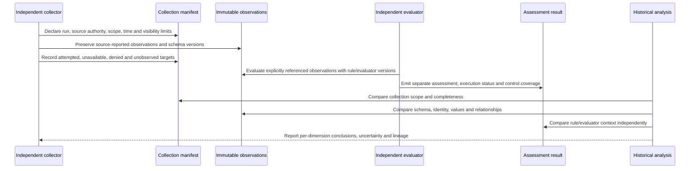

# Evaxis Evidence Envelope v0.1

**Status: Proposed; pending maintainer review and explicit architectural
approval.** This document is the human-semantic authority for the v0.1
contract. It does not assert that Evaxis has implemented collection, storage,
authenticity verification, comparison or assurance.

The machine-readable record shapes and synthetic conformance data are owned by
the [Evaxis core repository](https://github.com/evaxis/evaxis/tree/main/schemas)
and [conformance fixtures](https://github.com/evaxis/evaxis/tree/main/tests/conformance).
Those artifacts must align to this document's `0.1` semantic contract version.
If they disagree, this document governs intended meaning; the mismatch is a
conformance defect, not permission to silently reinterpret or coerce evidence.

## 1. Purpose, scope and limits

The envelope is a portable preservation boundary for evidence produced by
independent collectors and assessors. It allows historical preservation and
later evaluation without requiring Maester, an Evaxis runtime, a particular
cloud, execution model, API, database or language. It carries provenance and
comparison context alongside source-reported data; it does not itself prove
truth, completeness, freshness, authenticity or security.

The contract separates four records:

1. **Envelope** — package identity, contract version, producer/run references
   and integrity assertions for a submitted evidence package.
2. **Collection manifest** — what was intended, attempted, visible, unavailable
   or unsupported during a collection run, including scope and limits.
3. **Observation** — what a collector reported about a source object at a
   stated time, with native identity, source schema and preserved representation.
4. **Assessment result** — what a named rule and evaluator concluded from
   explicitly referenced observations and evaluation context.

A historical comparison is a derived analysis, not a fifth source observation.
It must retain references to both input envelopes, the identity-correlation
decision, comparison model, transformations and uncertainty. It must not
rewrite original records.

This is a portable evidence contract, not an API or storage protocol. The
draft specifies no transport, persistence technology, product language,
execution service, retention default or licensing terms.

## 2. Normative vocabulary

The words **MUST**, **MUST NOT**, **SHOULD**, **SHOULD NOT** and **MAY** are
normative requirements within this proposed contract. A requirement marked
**Proposed** is not approved until the proposal is accepted through repository
governance. An implementation claiming v0.1 conformance must identify its
contract version and disclose unsupported requirements.

**Evidence** is preserved source-reported material and context. **Observation**
describes that material. **Assessment** is an evaluator's interpretation.
**Collection completeness** describes visibility of the requested collection
scope. **Control coverage** describes which in-scope subjects were evaluated
for a particular assessment. Neither implies the other.

**Unknown** means available evidence cannot justify a conclusion. **Fail** is
an explicit negative assessment made by an identified rule/evaluator from
sufficient, accepted inputs; it is not a synonym for collection failure.
**Pass** is a rule result, not proof that the environment was unchanged or
fully observed.

## 3. Versioned contracts and record boundaries

The six independently changing version axes are:

| Axis | Identifies | Must not be substituted for |
|---|---|---|
| Envelope contract version | Envelope package shape and envelope-level semantics | Source schema or evaluator version |
| Observation schema/version | Source-specific meaning and representation of an observation | JSON structural validity or collector version |
| Collector identity/version | Collection implementation and release | Source authority or authenticated truth |
| Rule identity/version | Policy/control logic being evaluated | Evaluator implementation |
| Evaluator identity/version | Evaluation implementation and release | Rule semantics |
| Normalization/comparison model version | Declared transformation and comparison semantics | Original evidence or source schema |

Version identifiers are opaque, case-sensitive producer-owned identifiers
unless a later approved registry defines stronger syntax. A receiver MUST
preserve the exact supplied value. Missing required version context makes the
affected comparison insufficient or incomparable; a receiver MUST NOT infer a
version from a display name, filename, current release or similar payload.

The envelope has a unique opaque identifier scoped by its producer authority
and an assessment/collection run identifier. Identifiers need not be globally
unique. A consumer MUST use the producer authority with the identifier when
deduplicating or resolving references. Creation time, collection interval and
assessment time are distinct facts and MUST NOT be collapsed into one
timestamp.

An envelope MAY reference multiple source authorities and multiple observations.
Each observation and assessment MUST have an explicit record identifier and
versioned type/schema reference. The manifest describes the collection run;
it does not assert that every intended target was observed or every control
assessed.

## 4. Collection lifecycle, completeness and freshness

A collection begins with a declared run, source authority, intended scope,
collection start time, collector identity/version and declared configuration.
The collector records source attempts and their outcomes. It then emits zero
or more observations and a manifest that relates expected scope to what was
actually visible. An interrupted or failed run still has a start event when
one occurred; absence of a completion timestamp is not success.

Run-level and per-source attempt status MUST together distinguish at least:

- succeeded for the declared request;
- partial, where some requested work did not complete;
- failed, where the collector could not complete its operation;
- unsupported, where a source/object/capability is outside the collector's
  supported interface;
- unavailable, where the authority or data could not be reached;
- denied, where effective permissions prevented visibility;
- malformed, where received data could not be parsed or validated;
- not attempted, where no collection was made.

The detailed source-attempt status belongs in the manifest, not in an
assessment outcome. A manifest MAY report the overall run as complete only
relative to its declared requested scope and recorded limitations. It MUST NOT
claim whole-environment completeness unless the scope and visibility evidence
justify that exact claim. Permission names, scopes and visibility constraints
SHOULD be recorded in a least-disclosing form; credentials and tokens MUST NOT
be included.

For package consistency, target identity is the tuple `(authority, scopeId,
nativeId)`, not the complete serialized target object. Target tuples MUST be
unique within each of `expectedTargets`, `observedTargets` and `notObserved`.
`observedTargets` and `notObserved` MUST be disjoint subsets of
`expectedTargets`. A `complete` coverage claim requires exact equality between
`expectedTargets` and `observedTargets` and an empty `notObserved`; a `partial`
claim MUST account for every expected target in exactly one of the observed or
not-observed sets. Observations in the package MUST resolve to exactly the
manifest's observed target set. A `succeeded` collection requires complete
declared-scope coverage and all recorded source attempts to have succeeded.
These checks do not prove that the declared scope itself was adequate or
complete for the environment.

Collection completeness and control coverage MUST be reported separately.
The manifest describes source/target visibility and collection limitations.
Each assessment describes its assessed subjects and any unassessed subjects.
A successful collection can have no relevant control assessed; a fully assessed
control can still rely on a partial collection.

Freshness is contextual. An assessment SHOULD state the evidence timestamps it
used and the freshness policy or threshold applied. The comparison MUST expose
staleness or clock uncertainty as a limitation. Without a stated policy, age
threshold, usable timestamp or trustworthy clock basis, freshness is unknown;
v0.1 defines no universal maximum age. A newer ingestion time MUST NOT replace
the original collection time.

When a target is absent from a partial, failed, reduced-scope, denied or
otherwise incomplete collection, continuity is unknown. Non-observation MUST
NOT be interpreted as deletion, compliance, remediation or proof of absence.
Confirmed deletion requires positive, source-attributable lifecycle evidence
such as an authoritative tombstone or explicit deletion event, with its
authority, observation time and scope preserved.

## 5. Observation and assessment separation

An observation records what the collector reports: source authority, tenant or
organizational boundary as applicable, account/workspace/subscription-like
scope, source-native target identifier, optional display attributes, object
lifecycle claim, observation type, source schema/version, collection run,
observation time and source representation or reference. Payloads are
potentially sensitive and SHOULD be minimized to the requested purpose.

An observation MUST NOT embed a security `Pass` or `Fail` as its meaning.
Source-reported status, if present, must be labeled as a source attribute and
must not be confused with an Evaxis assessment.

An assessment result identifies the rule and version, evaluator and version,
subject/target, exact observation references, assessment time, outcome and any
normalization/comparison model used. It also records execution status and
coverage. It MUST declare an input basis: referenced observations, declared
scope, external references, or no input, with a rationale. Observation-based
assessments MUST reference at least one observation; external-reference
assessments MUST identify their external references. A completed `Pass` or
`Fail` MUST NOT have unknown control coverage or a `no-input` basis. A rule
whose intended basis is not represented by these options is insufficiently
specified for a v0.1 assessment. Rule execution failure, unsupported rule
version, unavailable
observations and malformed inputs yield an explicit error/unknown/unsupported
state, not a fabricated control result.

The outcome vocabulary is **Pass**, **Fail** and **Unknown**. Execution and
trust states are separate dimensions: a completed assessment may return
Unknown; an evaluator failure is not a control Fail; a cryptographic
verification error is not a source observation of insecure configuration.
Rule and evaluator versions are both necessary to interpret results.

## 6. Evidence identity and lifecycle

Identity is authority-relative, not universal. A source-native target
identifier MUST be interpreted with its source authority and applicable scope
(tenant/account/workspace or equivalent). Native identifiers are not presumed
globally unique or stable across authorities, scopes or migrations. A consumer
MUST preserve the original identifiers and authority context.

Display names, labels, paths, tags and other mutable attributes MUST NOT alone
establish continuity. A rename is consistent with the same object only when
the authority-scoped native identity and lifecycle evidence support it. A
delete-and-recreate operation can reuse a display name while representing a
replacement object. Different native identifiers under the same authority and
scope establish distinct source identities; without lifecycle or migration
evidence they do not prove that one replaced the other. New native identity
under the same name MUST NOT silently inherit the old object's history.

The producer MUST distinguish observed identity from an inferred correlation.
Correlations MUST identify method, evidence/basis, source scopes, candidate
identities and confidence/ambiguity. Confidence is descriptive, not a
probability unless its calibration is defined. Ambiguous correlations MUST
remain ambiguous; consumers MUST NOT choose the most convenient candidate.

For source migration or changed scope, preserve both old and new identifiers
and the migration/correlation claim. Evaxis cannot establish that two provider
identifiers identify one real-world object without trustworthy upstream
evidence or a separately approved correlation process. Relationships between
objects are separately identified, authority-scoped observations; changes to
edges are not erased by unchanged node identities.

The upstream authority may guarantee identifier stability, lifecycle events,
timestamps, query visibility or deletion tombstones. Evaxis cannot create these
guarantees. A collector can attest only to its own behavior and inputs to the
extent independently verifiable. The envelope MUST preserve the origin and
confidence of each identity claim rather than imply an Evaxis-global identity.

Repeated observations within or across runs are separate observations unless
an explicit immutable identifier and provenance establish their relationship.
Matching content does not prove that the same object, authority, time or
collection event is involved.

## 7. Provenance, integrity, authenticity and replay

At minimum, a collection manifest records producer/collector identity and
version, run identifier, configuration identity/version or a privacy-reviewed
configuration digest, source authority, declared scope, start/completion time,
source-attempt outcomes and known visibility/permission limits. An observation
records the run and source-native target identity, observation time, schema
version, representation and an optional content digest with explicit algorithm
and coverage. An assessment records rule/evaluator identity and versions,
assessment time and observation references.

A content digest can detect a change relative to bytes and an algorithm chosen
by the producer; it does not identify who created those bytes, prove that a
collector queried the claimed source, prove freshness, or establish that the
source response was truthful or complete. Digest coverage and representation
encoding MUST be explicit enough to interpret. Consumers MUST NOT silently
recompute, canonicalize or compare digests over different byte representations.
v0.1 does not mandate a digest algorithm.

The envelope and observation schemas contain producer-supplied claims only.
Fields such as `claimStatus: claims-verified`, `identityClaimStatus:
claims-authenticated`, a named verifier, or a verification time MUST NOT be
promoted by a consumer into established verification or authenticated identity
merely because the record validates. The schema validates the claim's shape;
it cannot establish who made the claim or whether verification occurred.

Any receiver verification result is a separate, receiver-owned derived record
outside the immutable producer package. It MUST identify the receiver/verifier,
the exact immutable record or digest and verification scope, method, result,
time, and trust context. It MUST preserve the original producer claim and
verification inputs; it MUST NOT rewrite producer fields or make a claim
retroactively authoritative. A consumer MUST distinguish absent, failed,
unavailable and successful receiver verification. v0.1 defines no schema or
cryptographic mechanism for this derived record, and absent such a record the
verification state remains unestablished. Signature metadata MAY be carried
opaquely for future interoperability, but v0.1 specifies no signature
algorithm, PKI, trusted issuer set, key custody, encryption or verification
service. A signature over a record does not prove collection completeness or
source truth.

For an observation representation, exactly one of `content` or `reference`
identifies the captured representation. If `content` is present with JSON
`null`, that is an explicit source-reported null value, not missing evidence.
An omitted content/reference is structurally invalid; absence of a field inside
the captured content is interpreted only by its declared source schema.

Duplicate submission and replay are different. Within an identified producer
authority, the same envelope identifier with the same immutable bytes/digest
and contract context SHOULD be treated idempotently as an already-ingested
submission. Reuse of that identifier with different content is an integrity
conflict and MUST NOT overwrite the original. A repeated observation under a
different envelope may be a legitimate repeated collection, backfill, retry or
replay; do not reject it solely because payloads match.

Older evidence is potentially replayed or simply delayed. A receiver SHOULD
compare collection time, envelope identity, ingestion history and any
source-provided sequence/version against an explicit replay/freshness policy.
It MUST preserve original times and distinguish warning, policy rejection and
duplicate acknowledgment. Clock skew, offline collection, delayed delivery and
source-history gaps limit detection. No replay-prevention guarantee is claimed
without an enforced, durable receiver policy and adequate source/collector
signals.

Integrity means the recorded bytes match the stated digest/verification
assertion. Authenticity concerns the source of a claim. Truthfulness concerns
whether the claim corresponds to the environment. Freshness concerns its time
relevance. Completeness concerns visibility. These properties are independent.

## 8. Environmental drift and evaluator drift

Historical comparison MUST evaluate independent dimensions before stating an
environmental conclusion:

| Dimension | Examples | What it does not prove |
|---|---|---|
| Environment | Comparable captured configuration/observation values differ | That all relevant environment state was collected |
| Collection | Scope, permissions, source availability, collector/configuration or observed target set changes | Remediation or deletion |
| Representation/schema | Source schema version, type meaning, encoding or structure changes | Semantic equivalence or environmental change |
| Identity/lifecycle | Native ID, authority, scope, correlation confidence, rename, delete/recreate | Continuity based on display name |
| Relationship | Parent/child, membership, attachment or dependency edge changes | That either endpoint's properties changed |
| Rule/evaluator | Rule definition or evaluator implementation/version changes | Environmental change when observations are unchanged |
| Trust/freshness | Provenance, digest, authentication, integrity, timestamp or age changes | Source truth or complete visibility |
| Coverage | Requested scope, collection completeness or assessment coverage changes | Pass, remediation or security improvement |

An environmental conclusion is supportable only when evidence for the
compared values is structurally valid, package references resolve,
semantically comparable, sufficiently fresh under a declared policy, tied to
the same sufficiently correlated subject, and collected over compatible
scopes with adequate declared-scope coverage and acceptable receiver trust
context. Each prerequisite and its evidence basis MUST be recorded. If
receiver verification is absent, a consumer may report a difference between
the preserved source-reported evidence records, but MUST NOT present that
difference as established environmental change. A conclusion made under a
declared but unverified trust assumption MUST be labeled conditional and name
that assumption. If any prerequisite is unknown, the result must be partially
comparable, incomparable or insufficient evidence as appropriate, not an
asserted environmental change or no-change.

Different configuration with the same `Pass` is environmental drift plus
unchanged outcome for those compared values when the values are comparable and
the rule/evaluator contexts are stable. Identical observations support only
"no observed difference in the compared values within the declared scope";
they do not establish that the environment as a whole did not drift. An
unchanged observation with a different result under a
stricter rule or changed evaluator is evaluation drift, not environmental drift.
An unchanged `Pass` does not prove unchanged environment: a rule may accept
multiple configurations, compare only a subset, or miss a changed property.
Passing a security test is therefore never evidence that the underlying
environment remained unchanged.

A comparison MUST retain the input envelope/observation references, identity
correlation decision, each dimension's conclusion, rule/evaluator versions,
schema/comparison-model versions, collection and assessment coverage, freshness
and trust limitations, and any transformation lineage. A single summary label
MUST NOT erase these dimensions.

## 9. Structural and semantic compatibility

Schema validation answers whether a record conforms to a declared structural
shape. Semantic compatibility asks whether the records describe the same
concepts under comparable units, enumerations, scope, identity and collection
meaning. Structural validity is necessary, not sufficient, for semantic
comparability.

Package-level conformance is separate from individual record validation. A
consumer MUST resolve envelope manifest/observation/assessment references
within the package; require matching envelope/manifest run identifiers and
observation/manifest run membership; resolve assessment observation references;
and enforce the target coverage invariants in section 4. A completed
observation-based assessment MUST resolve its references and include at least
one observation for its assessed subject. Unresolved, duplicate, cross-run or
inconsistent references invalidate the affected package/assessment and MUST NOT
be silently dropped.

Conformance claims MUST identify their level. Structural schema validation
establishes only shape and declared constraints. Package consistency validation
establishes only the tested reference, run-membership and coverage invariants.
Synthetic semantic expectations state required behavior under their declared
preconditions; they are not executable comparison results. Behavioral
conformance requires tests against an implementation and is not established by
the v0.1 schemas or fixture validator.

Compatibility outcomes are:

- **Comparable** — same meaning and scope under a declared compatible contract;
- **Comparable after documented transformation** — a named/versioned
  transformation preserves source lineage, input/output identifiers and
  digests, and does not mutate or replace original records;
- **Partially comparable** — a defined subset has compatible meaning; list the
  comparable and excluded dimensions/subjects;
- **Incomparable** — known semantic, identity, scope or representation
  differences prevent a defensible comparison;
- **Insufficient evidence** — missing, malformed, incomplete, untrusted, stale
  or uncertain inputs prevent a conclusion.

No automatic coercion, schema migration or normalization may imply equivalence
without a documented mapping, model version, provenance and explicit
compatibility decision. Transformations produce derived records and MUST
preserve the immutable original. Lossy transformations must identify omitted
information and can only reduce the scope of a conclusion.

If two schema versions use the same JSON shape for different meanings, they are
not semantically compatible. Conversely, equivalent meanings represented by
different structures are comparable only after a declared transformation.
Unknown rule versions cannot be equated to known versions based on outcome
labels alone.

## 10. Versioning and evolution

Each record exposes the version axes relevant to its meaning. Envelope version
does not transitively pin source schemas, collectors, rules, evaluators or
normalizers. A change to one axis MUST NOT be represented as a change to
another axis.

The proposed version format uses `0.1` for the envelope semantic contract and
explicit version identifiers for component schemas and producer/evaluator
artifacts. A breaking change to required field meaning, identity semantics,
outcome interpretation or compatibility rules requires a new incompatible
contract version. Additive optional fields may remain compatible only when
unknown-field handling and extension boundaries are documented. Consumers
MUST reject unsupported required semantics explicitly rather than drop them.

Deprecation requires a documented successor, migration guidance, support
window decision and impact on comparisons. Original records remain immutable;
migrations append derived records with source references. Schema compatibility
must not be inferred solely from numerically ordered versions.

## 11. Privacy and security considerations

Evidence can expose security posture, organization structure, resource names,
policy gaps and operational metadata even without credentials. Collect only
purpose-limited fields, minimize direct identifiers, protect tenant boundaries,
and exclude credentials, tokens, private keys, live customer evidence and
secret-derived material from public fixtures.

Threats include cross-tenant evidence confusion; source/collector identity
spoofing; forged or overstated provenance; replay and stale evidence; malicious
collector output; sensitive metadata leakage; overcollection; ambiguous object
correlation; schema/semantic confusion; permissive or lossy transformations;
payload or digest substitution; and incorrect historical conclusions.

Consumers should isolate tenant/scope context, treat all imported content as
untrusted input, validate schema and cross-references, preserve originals,
apply explicit authorization and retention policy outside this contract, and
surface trust/coverage uncertainty. No assurance follows from syntactic
validation alone. A signed observation, if introduced later, would attest only
to what the signer signed under the selected trust policy; it would not prove
that the environment was completely observed.

## 12. Maester and adapter neutrality

Maester is one possible producer, consumer or adapter, not the normative model.
An adapter MAY preserve native Maester test/rule identifiers, target IDs,
source schema references and original outcomes in namespaced source metadata
alongside Evaxis record identifiers. It must preserve the distinction between
the observation and a Pester/Maester assessment result. The contract does not
depend on Maester test IDs, Pester outcome formats, Microsoft Graph structures,
Maester Cloud storage, Pack provider APIs or Cloud Plugin host functions.
No Maester-specific implementation or proposed interface is defined here.

## 13. Normative ownership and open decisions

`evaxis/architecture/specifications/evidence-envelope-v0.1.md` owns human
semantics, terminology, lifecycle, threat limits and compatibility decisions.
`evaxis/evaxis/schemas/` owns machine-readable structural constraints and
versioned record fields. `evaxis/evaxis/tests/conformance/` owns synthetic
instances and machine-readable expected results. Core documentation may
summarize the contract and link here but must not redefine semantics.

The repositories align via the explicit envelope contract version `0.1`, schema
version identifiers, reciprocal links and reviewed changes in both PRs. A
schema change that alters intended meaning requires a matching architecture
change. A human-semantic change without corresponding schema/fixture updates is
incomplete; no repository version alone silently supersedes the other.

Explicitly undecided: product language/build system; cloud, API transport,
storage and execution; collector authentication and authorization model;
cross-provider identity authority/correlation governance; digest/signature
algorithms and PKI; encryption, key custody/rotation; canonical serialization;
transformation approval; retention/deletion; licensing, contribution rights,
commercial entitlements and billing. These require separate investigation and,
where appropriate, approved ADRs. This draft selects none of them.

## 14. Illustrative lifecycle

The sequence is conceptual, not a deployed interface or selected execution
architecture. A comparison report cannot substitute for or alter its inputs.
